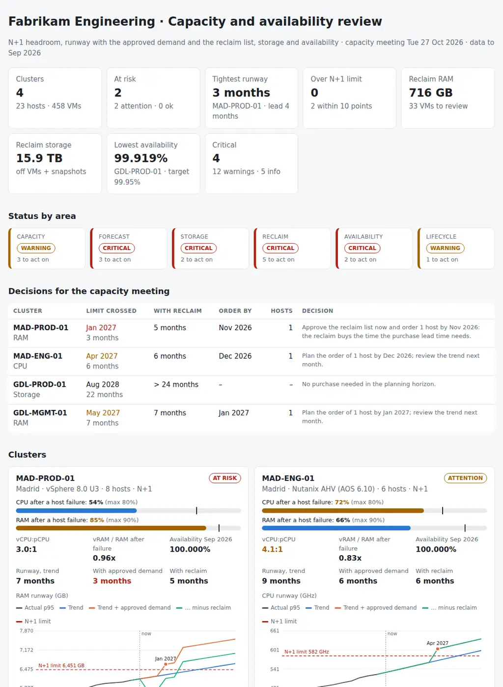

# Private Cloud Capacity Review

The monthly capacity and availability review of a private cloud: vSphere clusters, a Nutanix AHV cluster, their hosts, VMs and datastores. For every cluster it puts together:

- **Headroom after a host failure:** the CPU and RAM left when the largest host (or hosts) fails, against the maximum use allowed, the vCPU:pCPU ratio against the policy, and vRAM overcommit.
- **Runway:** a linear trend over 12 months of p95 utilisation, plus the approved projects at their go-live month, minus what the reclaim list gives back. The result is the month each cluster crosses its N+1 limit, set against the purchase lead time.
- **What to reclaim:** VMs powered off for 30 or 90 days, idle VMs, VMs oversized against their p95, old snapshots and VMs with no owner, with the RAM and storage each one gives back.
- **Storage and availability:** datastores below the free space threshold, thin provisioning above the policy, the month's cluster outages against the availability target, host failures and HA restarts, and hosts out of vendor support.

Eight CSVs, one JSON with the rules and one Python command give each cluster a verdict (**ok**, **attention** or **at risk**) and produce the pack for the monthly capacity meeting: **which cluster runs out first, whether the reclaim list buys enough time, and when the hosts have to be ordered.**

Python 3.10+, standard library only. It runs with fictional demo data out of the box. A read-only PowerShell exporter for vCenter (PowerCLI) and Nutanix Prism Central (REST API) is included.



## Why

Capacity is a date, not a percentage. A cluster at 74% of its RAM looks healthy on the dashboard. But take away the host that HA needs as a spare, and it is at 85% of what is left. It grows half a point a month. Two approved projects land in January and March. Put those three facts together and the cluster crosses its N+1 limit in January. New hosts take four months to order, deliver, rack and add to the cluster, so the decision was due in September.

The facts sit in different places. Capacity and utilisation are in vCenter and Prism Central. The projects are in the portfolio. The powered-off VMs and forgotten snapshots are in the inventory. The outages are in the incident records. A monthly capacity review joins them per cluster and turns them into a short list of decisions: the reclaim to approve, the projects that do not fit, and the order to place by a given month. The rules are in `settings.json` and `capreview/checks.py`.

## What it checks

| Area | Code | Finding |
|---|---|---|
| Capacity | CAP-01 | CPU or RAM p95 above `cpu_max_pct` / `ram_max_pct` of what is left after the failover hosts fail (critical); within `warn_margin_pct` of it (warning) |
| Capacity | CAP-02 | vCPU:pCPU of running VMs above `vcpu_ratio_max`; critical above 1.5 × the policy |
| Capacity | CAP-03 | vRAM of running VMs above `ram_overcommit_max` × the RAM left after a host failure |
| Capacity | CAP-04 | Hosts in maintenance or disconnected: the cluster is running without its failover capacity |
| Forecast | FCT-01 | The cluster crosses its N+1 limit (CPU, RAM or storage) with the approved demand within `purchase_lead_months` (critical) or `plan_horizon_months` (warning) |
| Forecast | FCT-02 | Runway of the clusters with nothing to decide (for information) |
| Forecast | FCT-03 | Fewer than `history_min_months` of utilisation history |
| Forecast | DEM-01 | Approved projects that do not fit at their go-live month |
| Forecast | DEM-02 | Demand items not in the forecast: not approved, no cluster or no date (for information) |
| Storage | STO-01 | Datastores below `datastore_warn_free_pct` free; critical below `datastore_crit_free_pct` |
| Storage | STO-02 | Thin provisioning above `thin_overcommit_max` × capacity |
| Reclaim | RCL-01 | VMs powered off for `poweredoff_warn_days`; from `poweredoff_reclaim_days` their storage counts as reclaimable |
| Reclaim | RCL-02 | Idle VMs: running, with CPU and RAM p95 below `idle_cpu_pct` and `idle_mem_pct` |
| Reclaim | RCL-03 | Oversized VMs: CPU or RAM p95 below `oversize_cpu_pct` / `oversize_mem_pct`, with the recommended size |
| Reclaim | RCL-04 | Snapshots older than `snapshot_max_days`; critical when older than `snapshot_crit_days` |
| Reclaim | RCL-05 | VMs without an owner |
| Availability | AVL-01 | Cluster availability in the month below `availability_target_pct` |
| Availability | AVL-02 | Host failures and VMs restarted by vSphere HA in the month |
| Availability | AVL-03 | Clusters that met the target (for information) |
| Lifecycle | LCM-01 | Hosts out of vendor support (warning) or leaving it within `support_warn_days` (for information) |
| Lifecycle | LCM-02 | Hosts behind the firmware baseline (for information) |

## Outputs

| File | What |
|---|---|
| `report.html` | Tiles, status by area, the decisions for the meeting (runway, order-by month, hosts to add), a card per cluster with the headroom after a host failure and the runway chart (inline SVG), "Fix first", the demand pipeline, reclaim candidates, datastores, availability, all findings |
| `capacity-review.md` | Summary, the decisions table with the purchase lead time against the runway, actions with owners, a section per cluster, demand, reclaim by cluster |
| `clusters.csv` | Every cluster: capacity, capacity after the failover hosts, p95 use, headroom, vCPU ratio, overcommit, availability, the three runways, order-by month, hosts to add, verdict and issues |
| `forecast.csv` | Month by month for every cluster and metric: actual, trend, with the approved demand, with the reclaim list, and the limit |
| `reclaim.csv` | Every candidate VM with the reason, the owner, what it gives back and the action |
| `datastores.csv` | Every datastore or storage container: capacity, free, provisioned, overcommit, status |
| `demand.csv` | Every demand item: whether it counts, the CPU it will use and whether it fits at go-live |
| `actions.csv`, `findings.csv` | The findings with owner and next step, ready for a tracker |

## Try it

```bash
git clone https://github.com/inigogonzalezgarcia/35-private-cloud-capacity-review.git
cd 35-private-cloud-capacity-review
python -m capreview demo
```

Open `output/report.html` and `output/capacity-review.md`.

### The demo data

The demo is a made-up engineering company, Fabrikam Engineering, with a private cloud in two data centres, Madrid and Guadalajara:

- four clusters with 23 hosts: two vSphere production clusters on Dell and HPE servers, a Nutanix AHV cluster for engineering simulation, and a three-host management cluster;
- 458 VMs, 7 snapshots, 8 datastores (NFS on NetApp, VMFS on Fibre Channel, vSAN and a Nutanix storage container);
- 13 months of utilisation, seven demand items and September's events, reviewed at the capacity meeting of 27 October 2026 with a four-month purchase lead time.

All names are fictional. The problems are placed on purpose:

- **Madrid production (vSphere):**
  - RAM at 85% of what is left after a host failure, rising 50 GB a month;
  - with the PLM upgrade in January and the engineering data platform in March, it crosses its N+1 limit in **January 2027, three months away**, inside the lead time;
  - the reclaim list (idle proofs of concept, oversized PLM and ERP servers, a retired PLM version still on disk) gives back 520 GB of RAM and 8.6 TB of storage. That moves the date to March, so the hosts can still arrive in time if they are ordered by November;
  - a host failed in September and HA restarted 31 VMs.
- **Madrid engineering (Nutanix AHV):** CPU-bound, with a 4.1:1 vCPU ratio, a storage container thin provisioned 1.72 times, and the simulation farm expansion that does not fit in April.
- **Guadalajara production (vSphere):** plenty of compute, but a VMFS datastore at 7% free. A 35-minute cluster outage after an array controller failover leaves September at 99.919% against a 99.95% target. Two hosts are out of vendor support.
- **Guadalajara management:** a host in maintenance waiting for a part, a 4.4:1 vCPU ratio and RAM that reaches its limit in May.
- **Reclaim across the estate:** 33 VMs, 716 GB of RAM and 15.9 TB of storage, including a 210-day-old snapshot taken "before ERP patch" and four VMs that nobody owns.

## Use it with your own private cloud

1. Export from vCenter and Prism Central with read-only accounts:
   ```powershell
   .\scripts\Export-PrivateCloudCapacity.ps1 -VCenter vc01.corp.local -Credential (Get-Credential) `
       -PrismCentral pc01.corp.local -PrismCredential (Get-Credential) -HostInventory .\data\host-support.csv -OutputFolder .\data
   ```
   - PowerCLI: `Get-Cluster`, `Get-VMHost`, `Get-VM`, `Get-Datastore`, `Get-Snapshot`, `Get-VIEvent`, and `Get-Stat` for `cpu.usage.average` and `mem.usage.average` (daily rollup per cluster, 2-hour rollup per VM).
   - Prism Central: the v3 `clusters/list`, `hosts/list` and `vms/list` calls, and the v4 `clustermgmt` storage containers and cluster statistics.
   - It only reads. Keep `data/utilisation.csv` between runs: every month adds one, beyond the year of daily values vCenter keeps.
2. Write `demand.csv` from the project portfolio, add the end time and ticket of each outage to `events.csv`, and adjust `data/settings.json`: N+1 limits, vCPU policy, purchase lead time, availability target ([docs/data-format.md](docs/data-format.md)).
3. Build the outputs:
   ```bash
   python -m capreview review --data data/ --title "Capacity review · November"
   ```

[docs/capacity-meeting-runbook.md](docs/capacity-meeting-runbook.md) has the preparation, the 45-minute agenda and how to read each signal.

The exports contain host names, VM names, owners and project plans. Keep them inside your organisation:

- real files at the top level (`clusters*.csv`, `hosts*.csv`, `vms*.csv` and the rest, `settings.json`, `data/`) and the `output/` folder are excluded from Git by `.gitignore`;
- only the fictional files in `sample_data/` are committed.

## Design notes

- **N+1 is computed, not assumed.** The largest hosts are removed separately for CPU and RAM, so a mixed cluster is judged by the host it would lose.
- **The forecast is simple on purpose.** It takes the latest p95, the least-squares slope of the last 12 months, the approved demand stepped in at its go-live month, and the reclaim from the month after the meeting. Anyone at the meeting can check it in `forecast.csv`.
- **New projects use today's CPU per vCPU.** A new vCPU is expected to use what an average running vCPU of the same cluster uses today, capped at one core; RAM counts in full.
- **Reclaim counts each VM once.** An idle VM that is also oversized gives back its RAM once; powered-off VMs give back storage, not RAM.
- **The order-by month comes from the date with reclaim.** It is the month the forecast with the reclaim list crosses the limit, minus the lead time, so the reclaim the owners accept is what makes a late order still possible.

## Tests

```bash
pip install -r requirements-dev.txt
python -m pytest -q
```

GitHub Actions runs them on Python 3.10 and 3.12 on every push, then rebuilds the fictional sample data and the report screenshot from the simulator.

15 tests: hosts and VMs exported with PowerCLI property names, Spanish names, semicolons and decimal commas; months and vCenter event types; settings and the required files; headroom after one and two host failures in mixed clusters; vCPU ratio, RAM overcommit and hosts in maintenance; the trend runway; how approved demand and reclaim move it, demand that does not fit and the decision text; short history and the storage limit; powered-off, idle and oversized VMs with the recommended size; snapshots, owners and savings counted once; datastore thresholds and thin provisioning; availability inside the month and HA restarts; vendor support and firmware; and the demo end to end (deterministic, all nine outputs, the Madrid cluster crossing its N+1 limit in January).

## Next steps

- Read Nutanix VM statistics from the v4 `vmm` API so AHV VMs are judged idle or oversized like the vSphere ones.
- Add Red Hat OpenShift clusters: node capacity and pod requests from the cluster, with the same N+1 and runway logic.
- Write each month's decisions and accepted reclaim back, so the next review shows what was done and how the forecast compared with what happened.
- Cost per host and per GB in the settings, to put a price next to each decision: reclaim, right-size or buy.

## Background

Built from my work running private cloud and infrastructure:

- vCenter and vSphere, VMware VCF, vSAN and NSX-T, Nutanix, Red Hat OpenShift and Hyper-V, and HPE Private Cloud Business Edition / GreenLake;
- SAN and NAS storage including NetApp, and Dell, HP and Supermicro servers;
- formal availability and capacity management (metrics, trends, availability plans), technical feasibility and cost and resource estimation, and changes through the CAB;
- cost optimisation in Azure (right-sizing and reservations), the same habit applied here to VMs on premises.

Written from scratch with fictional data; no employer data, systems or exports are used.

## Customisation and contact

Want this adapted to your private cloud? For example:

- your clusters, N+1 policy, vCPU ratio and availability targets;
- your vCenter, Prism Central or other platform exports;
- your project portfolio as the demand pipeline, and your purchase lead times;
- the pack sent before every capacity meeting.

Get in touch:

- Website (contact form): [inigogonzalezgarcia.github.io](https://inigogonzalezgarcia.github.io/about.html#contacto)
- LinkedIn: [linkedin.com/in/igonzalez93](https://www.linkedin.com/in/igonzalez93)

## License

MIT
